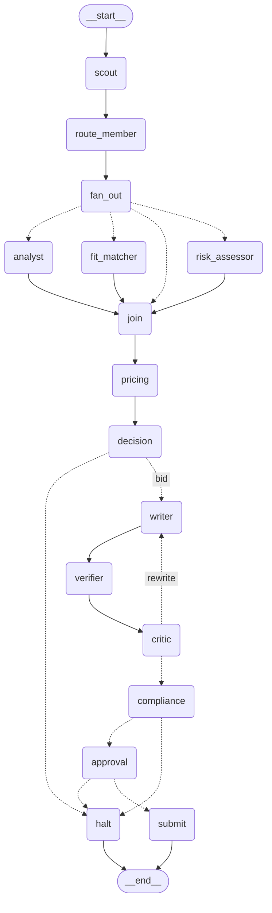

# GigBid

A team of agents that reads a freelance job feed, decides which jobs are worth bidding
on, drafts proposals grounded in portfolio evidence, and handles client replies. A human
approves every proposal and every message before it leaves the system, and every claim in
a draft points at the portfolio item that supports it.

Built for AI-4016 Assignment II. It runs against GigSim, the marketplace simulator, and
against Upwork's official MCP server in live mode, where writes are drafts only.

<!-- DEMO: replace this comment with the 30-second GIF once it is recorded.
     
     The clip to record: inbox, analyse a job, the requirement-to-evidence matrix,
     the studio with its evidence hovers, approve, the Connects spend. -->

## The bid graph

One thread per job. Scout hands the job in; a routing node picks which team member bids;
three analyses run concurrently; a decision node bids or skips; drafting runs through a
bounded critique loop; the graph stops for a human before anything is sent. Rendered from
the compiled graph by `make graphs`, so it cannot drift from the code.



The conversation graph, the state and the reducers are in
[docs/ARCHITECTURE.md](docs/ARCHITECTURE.md).

- Architecture, including both graphs: [docs/ARCHITECTURE.md](docs/ARCHITECTURE.md)
- Every MCP tool, with its annotations and allowlists: [docs/TOOLS.md](docs/TOOLS.md)
- Running it, and what breaks: [docs/RUNBOOK.md](docs/RUNBOOK.md)
- Where the data comes from: [docs/DATA_CARD.md](docs/DATA_CARD.md)
- AI tool usage: [docs/AI_USAGE.md](docs/AI_USAGE.md)

## What it does

A worker sweeps saved searches on a schedule and queues new jobs, deduplicating reposts so
the same job is never analysed twice. For each job, three agents run in parallel: the Job
Analyst extracts a structured spec, the Risk Assessor scores scam and policy signals, and
the Fit Matcher retrieves portfolio evidence for each requirement separately. Their
outputs join, a rule prices the bid against market rates and the client's history, and a
decision node bids or skips with a stated deciding factor.

On a bid, the Writer drafts from the retrieved evidence only. The verifier splits the
draft into claims and checks each one against the evidence, removing what it cannot
support. The Critic can send the draft back twice, no more, and the bound is enforced by
the graph's router rather than requested in a prompt. The Compliance Guard checks the
marketplace policy pack. Then the graph interrupts and waits for a person, who can
approve, edit or reject. Nothing is sent and no Connects are spent without that approval.

Job posts and client messages are treated as untrusted input. Instruction-shaped text is
removed before any prompt sees it, and its presence is recorded as a risk signal.

## Quick start

Python 3.11+ and Node 20+.

```bash
python -m venv .venv && . .venv/Scripts/activate   # or .venv/bin/activate
make install
cp .env.example .env            # set OPENAI_API_KEY (or GROQ_API_KEY) for model calls
make seed                       # synthetic personas, clients, scams, injections, dev set
make ingest                     # chunk and index the portfolio corpora
```

Then, in separate terminals:

```bash
make gigsim                     # marketplace simulator        :8081
make api                        # FastAPI                      :8000
make web                        # Next.js                      :3000
```

Sign in with `reviewer` and the password in `REVIEWER_PASSWORD`. Without a provider key
the system still runs end to end: drafts become placeholders, every rule-based decision is
unaffected, and the UI says so in a banner rather than pretending.

The whole stack in containers, including Postgres, Redis and the three MCP servers:

```bash
make up                         # docker compose -f infra/docker-compose.yml up --build
```

## Repository map

| Path | What is there |
|---|---|
| `mcp_servers/portfolio` | Portfolio MCP server: 4 tools, 5 resource templates, 5 prompts, read-only |
| `mcp_servers/marketplace` | Marketplace MCP server: 11 tools, idempotent writes, GigSim and Upwork adapters |
| `mcp_servers/workspace` | Calendar and email drafts |
| `mcp_servers/_common` | Bearer auth, token bucket, PII masking, append-only audit log, idempotency store |
| `rag/` | Ingestion, chunking, five retrieval variants, claim verification |
| `agent/` | State, hand-offs, nodes, both graphs, prompts, memory, checkpointer, tracing |
| `apps/api` | FastAPI: auth, jobs, runs with SSE, approvals, messages, insights |
| `apps/web` | Next.js app: inbox, job detail, proposal studio, run viewer, pipeline, analytics |
| `worker/` | Scheduled sweeps and the dedupe ledger |
| `evals/` | Runners, thresholds, datasets, and committed results |
| `infra/` | Compose file and the two Dockerfiles |
| `gigsim/` | The provided simulator, unchanged |

## What is measured

Every number below comes from a file in `evals/results/`, regenerated by
`make results-table`, which computes nothing itself. A missing cell is printed as a gap
rather than filled in.

The retrieval and decision tables are in
[evals/results/results_table.md](evals/results/results_table.md). The findings worth
stating in prose:

**Requirement decomposition is the only retrieval component that earns its keep.**
Retrieving once per requirement instead of once per job post is worth 6.9 Recall@5 points
over the naive dense baseline, 0.651 against 0.582, and costs about 50 ms a query.

**Reranking made retrieval worse.** This is the result I did not expect and the one worth
reading the files for. In the ablation, *removing* the reranker raised Recall@5 by 9.8
points, 0.563 to 0.661, and nDCG@10 by 15.5. The real cross-encoder is no better:
`BAAI/bge-reranker-base` needs 11.7 seconds a query on CPU to finish 1.0 point above the
baseline it was supposed to improve on, which for a six-requirement job is over a minute
against a declared 25-second analysis budget. The reading that fits both results is that
reranking is a precision tool for deep candidate pools, and a 197-item corpus is not one:
the hybrid retriever has already seen every candidate, so a reranker can only reorder, and
here it reorders worse.

So the shipped configuration is decomposition over hybrid retrieval with no reranking at
all (`V12`, `rag/variants/v12_decompose_hybrid.py`). There is no model in the retrieval
path, which is also why retrieval cost grows by milliseconds per requirement rather than
by seconds. Shipping the cross-encoder because it is the more sophisticated component
would have cost 9.8 points of recall and most of the latency budget.

**Claim verification catches every planted fabrication, and over-flags a little.** Against
180 labelled sentences generated from the real corpora, it caught 108 of 108 fabrications,
with flag precision 0.947 and F1 0.973: inflated numbers 36/36, false credentials 36/36,
substituted technologies 36/36. Six of 36 supported claims were flagged as well, which
costs the draft a true selling point and is the error direction to keep working on.
The technology check was added because of this measurement: before it, the verifier caught
every inflated number and every false credential and none of the 36 wrong-technology
claims, because substituting one word leaves the overlap score almost unchanged.
`make verify-eval`.

**Scam detection and injection defence.** Over the 198-job dev set: scam detection
precision 0.750, recall 1.000, F1 0.857; every one of the 24 planted prompt injections was
detected, with an attack success rate of 0.000 and no false positives on clean jobs.
`make decision-eval`.

**Exactly-once survives a crash.** `make crash-resume` kills the process while a proposal
waits for approval, restarts it, and approves once. All seven invariants hold across three
real OS processes, including the Connects balance and the proposal count:
`evals/results/c6_crash_resume.json`.

**Tool granularity (R&D question A).** 40 tasks against the Portfolio server, three tool
designs, scored on whether the right tool was called with the right arguments. Eleven
tools with rewritten descriptions scored highest on selection, 0.925, against 0.892 for
seventeen fine-grained tools and 0.850 for four coarse ones. Argument accuracy barely
moved, 0.850 against 0.838 and 0.825, while mean tokens per task rose from 781 to 1,465.
The coarse design is half the cost for four points of selection accuracy, so the right
choice depends on which error is more expensive: 17 tools cost more tokens *and* selected
worse than 11, so more tools is not simply better.
`evals/results/rnd_a_tool_granularity.json`.

**Agency mode (the signature extension, X1).** One GigBid for a small team: a routing
node picks the member whose portfolio covers the job before any analysis runs. Over 30 dev
jobs it committed to a member 24 times and was right 22 of those, 0.917 accuracy, declining
the other 6 under its margin and coverage rules. Mean coverage rose from 0.878 for the best
fixed member to 0.897, which is +1.95 points for three times the retrieval. That small gain
is the honest headline: this dev feed is dominated by AI/ML work, so a single member is
already near the ceiling, and agency mode pays off in proportion to how mixed the feed is.
`make agency-eval`, design and discussion in [docs/EXTENSION.md](docs/EXTENSION.md).

**Is the multi-agent design worth it (R&D question C)?** Not on decision quality, on this
sample. Twelve dev jobs stratified across kind and gold decision, three arms, the same
retrieved evidence shown to each so none has a retrieval advantage:

| Arm | bid/skip accuracy | bid F1 | scam recall | unsupported claims / proposal | tokens / job | ms / job |
|---|---|---|---|---|---|---|
| Single ReAct agent | 0.750 | 0.571 | 1.000 | 0.00 | 1,638 | 2,306 |
| Prebuilt supervisor | 0.500 | 0.000 | 1.000 | 2.00 | 8,829 | 14,049 |
| This hand-built graph | 0.750 | 0.571 | 1.000 | 0.00 | 4,149 | 88,258 |

The single agent ties the graph on accuracy and bid F1 at 40% of the tokens and under 3%
of the latency. Twelve jobs is a small sample and one job moves accuracy by 0.083, so the
tie is a tie and not a win for either.

What separates them is not the decision. The supervisor wrote 2.00 unsupported claims per
proposal because it has no verifier between drafting and output, which is the failure the
graph exists to prevent and the one that costs a freelancer their account rather than one
contract. The graph's 88 seconds a job buys three parallel analyses, retrieval per
requirement, claim verification, a bounded critique loop, a compliance pass and a durable
interrupt; the single agent's 2.3 seconds buys one model call and a promise.

The graph also loses jobs it should win. On injected posts it scores 0.333 against the
supervisor's 1.000, because injection detection is wired as a risk signal that can push a
decision to skip, and these planted posts are otherwise good jobs whose gold label is bid.
That is a conservative bias I would defend to a user and would still rather fix: the
instruction should be stripped and ignored without the post being penalised for having
contained one. `evals/results/rnd_c_agent_comparison.json`.

**Budgets against measurements (E5).** Declared budgets live in `agent/config.yaml`;
`make budget-report` reads the span logs and compares. On the runs recorded so far, p95
analysis latency is 7.6 s against a declared 25 s, p95 proposal latency 79.4 s against 90 s,
and cost per proposal $0.0069 against $0.05. Tokens per proposal exceeded its budget:
24,298 against a declared 20,000. The budget was set before the Writer was given the full
evidence block; the measurement is right and the declaration was optimistic.

## Operations

```bash
make worker-once      # one sweep, ignoring the schedule
make worker-stats     # what the ledger has seen; duplicates suppressed
make smoke-eval       # the CI quality gate; thresholds in evals/thresholds.json
make trace-summary    # one run's spans by node, with tokens, latency and cost
make budget-report    # declared budgets against measured values
make persistence      # what persistence is configured, and whether it survives a restart
make graphs           # both graphs as Mermaid, rendered from the compiled code
```

CI runs linting, the test suite and the tool-schema snapshots on every push, and the smoke
eval as a quality gate: a measured value below any threshold in `evals/thresholds.json`
fails the build. Tool schemas are snapshot-tested, so changing a tool's signature fails CI
until the snapshot is updated deliberately.

Traces are written locally as one JSONL file per run under `data/audit/traces/`, with
tokens, latency and cost per node. `make trace-summary` prints one by node. Langfuse is
used when `LANGFUSE_PUBLIC_KEY` and `LANGFUSE_SECRET_KEY` are set, and the three public
trace links the brief asks for come from there: run `make demo` three times with those keys
set, then copy the share links into the table below.

| Run | Link |
|---|---|
| A job analysed and skipped | _paste the Langfuse share link_ |
| A proposal drafted and approved | _paste the Langfuse share link_ |
| An injected instruction ignored | _paste the Langfuse share link_ |

## Tests

```bash
make test             # 191 unit, integration and contract tests
make test-graphs      # routing, reducers, loop bounds and interrupts, model forced offline
make test-api         # auth, approvals, idempotency, SSE
make e2e              # seven Playwright journeys against the real stack
```

The graph and e2e suites force the model offline. What they check is wiring: that
approving resumes the graph, that it spends Connects exactly once, that rejecting sends
nothing, and that editing sends the human's text. A suite whose result depends on what a
model happened to write is not a suite.

## Safety and human control

- Every outward action is behind a LangGraph interrupt. The Writer holds no send tool;
  only the Client Liaison can send a message, and only in a node downstream of an approval.
- Job posts and client messages are sanitised before any prompt sees them, and injection
  attempts are recorded as risk signals rather than silently stripped.
- No sentence survives into a draft unless the portfolio supports it. What cannot be
  verified is removed and shown to the reviewer as removed.
- Per-agent tool allowlists are enforced in `agent/mcp_client.py`, so an agent cannot call
  a tool its role does not justify.
- Live Upwork mode writes drafts only. Nothing is submitted to a real marketplace.
- Rules, thresholds, prompts and model routing live in `agent/config.yaml` and
  `agent/prompts/`, which is what made the GigSim policy change a configuration edit.

## Write-up

[docs/WRITEUP.md](docs/WRITEUP.md) is the technical write-up: what the reranking result
was, how a metric bug hid it for a full evaluation run, and what I would measure next.

## Known gaps

- **Judge calibration** needs the `human_*` columns of
  `evals/datasets/hand_check_sample.csv` filled in by a person. The runner refuses to
  report a kappa against labels it generated itself.
- **R&D question C** ran on 12 stratified jobs, not the 50 the brief suggests. Three arms
  over 50 jobs needs roughly 775k tokens against a free-tier limit of 200k per day per
  model, and the arms are rate-limited to 8k tokens a minute, so the full run is a day of
  wall-clock time rather than a cost problem. The committed result says its sample size on
  every line that quotes it.
- **The evidence-hover end-to-end spec skips when the model is offline.** A placeholder
  draft makes no claims, so there is nothing to hover. Six of the seven journeys pass
  offline; this one needs a provider key to execute.
- **No demo GIF or public trace links yet.** Both need a run with a provider key and a
  Langfuse project; the README has the slots marked.
- **GigSim reply rate and hire rate** are columns the results table leaves as gaps. The
  simulator does not model client replies, so there is no measurement to report rather
  than a number to invent.
