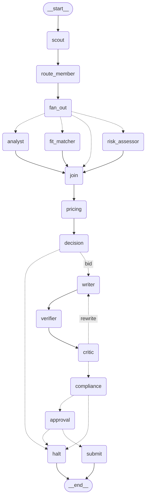
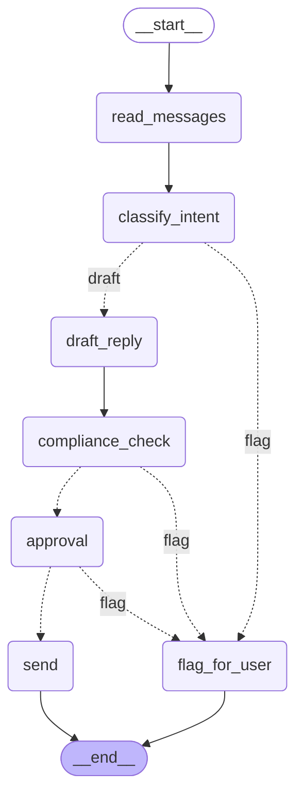

# Architecture

Two graphs, nine agent roles, three MCP servers of ours and two third-party, behind one
marketplace port. This document says what each piece is for and, where a choice was
contested, why it went the way it did.

Both diagrams are rendered from the compiled graphs
(`python -c "from agent.graphs.bid_graph import render_mermaid; print(render_mermaid())"`),
so they cannot drift from the code they describe.

## The whole system

```
                      ┌──────────────────────────────────────────┐
  Next.js UI  ───────▶│  FastAPI  (SSE stream, approvals resume) │
                      └───────────────┬──────────────────────────┘
                                      │
                   ┌──────────────────┴───────────────────┐
                   │                                      │
          ┌────────▼─────────┐                  ┌─────────▼────────┐
          │   bid graph      │                  │ conversation     │
          │  (1 per job)     │                  │ graph (1/thread) │
          └────────┬─────────┘                  └─────────┬────────┘
                   │         Postgres checkpointer        │
                   │         + LangGraph store            │
                   └──────────────────┬───────────────────┘
                                      │  per-agent tool allowlists
                   ┌──────────────────┼───────────────────┐
                   │                  │                   │
          ┌────────▼───────┐ ┌────────▼───────┐ ┌─────────▼───────┐
          │ Portfolio MCP  │ │ Marketplace    │ │ Workspace MCP   │
          │ (read only)    │ │ MCP (r/w)      │ │ (calendar/draft)│
          └────────┬───────┘ └────────┬───────┘ └─────────────────┘
                   │                  │
          ┌────────▼───────┐ ┌────────▼────────────────┐
          │ RAG: V0..V8    │ │   MarketplacePort       │
          │ chosen by eval │ │  (the only mode switch) │
          └────────────────┘ └────────┬────────────────┘
                                      │
                         ┌────────────┴────────────┐
                    ┌────▼─────┐            ┌──────▼──────┐
                    │  GigSim  │            │ Upwork live │
                    │  (dev)   │            │ (MCP+OAuth) │
                    └──────────┘            └─────────────┘
```

## Bid graph (C1)

One thread per job. Scout hands a job in; a routing node picks which team member bids
(a pass-through unless agency mode is on, see `docs/EXTENSION.md`); the three analyses run
concurrently; a decision node chooses; drafting runs through a bounded critique loop; the
graph stops for a human before anything is sent.

The diagram below is rendered from the compiled graph by `make graphs`, so it cannot drift
from the code.



### Why the fan-out is real, and what it cost

`fan_out` returns three `Send` objects, so LangGraph runs the analysts concurrently. Two
consequences that took finding:

**Every concurrently written field needs a reducer.** Three nodes returning
`execution_trace` into a plain field is a lost update — LangGraph cannot know whether the
second write extends or replaces the first, so it replaces, and two of the three traces
vanish. `agent/state.py` declares a reducer for every such field, and
`test_every_concurrently_written_field_declares_a_reducer` fails if a new one appears
without one.

**The Fit Matcher cannot read the Analyst's output.** It originally took `requirements`
from `job_spec`, which the Analyst produces — in parallel. So it always saw nothing and
reported 0% coverage on every job, and every thread skipped. It now derives requirements
from the post itself using the same rule-based decomposition V1 uses. If a node in the
fan-out reads another branch's output, the fan-out is decorative.

Pricing runs *after* the join, not inside it: it needs the client history the Risk
Assessor fetched.

### Rules or models, per node

Not a stylistic preference. The rule-driven nodes are the ones with measured accuracy, and
a model that merely re-scores a number a rule already computes adds cost, latency and a
failure mode for nothing.

| Node | Decided by | Why |
|---|---|---|
| Scout | rule | Fetch and sanitise. Nothing to judge. |
| Job Analyst | **model** | No rule turns prose into a requirement list. Rule fallback on failure. |
| Risk Assessor | **rule** | 0.857 scam F1, recall 1.000 on 24 planted scams. The model only phrases the explanation; the rule keeps the score. |
| Fit Matcher | rule + model veto | Coverage counted by rule; the model may *remove* coverage it thinks is topical adjacency, never grant it. |
| Pricing | **rule** | A clamp between three numbers. 0.752 inside the fair band. |
| Writer | **model** | Nothing else can write. |
| Verifier | **rule** (+ model on partials) | Numeric and citation checks need no model, and a verifier that cannot run must not approve by default. |
| Critic | **model** | Judging personalisation needs reading. |
| Compliance | rule + model | Contact details and guarantees are findable by pattern, so patterns find them; the model reads for what a pattern cannot catch. |

The Fit Matcher's veto direction is deliberate: models are better at spotting a bad match
than at vouching for a good one, and that direction cannot inflate coverage.

### Loop bounds (C4)

The Critic may ask for a revision as often as it likes. `route_after_critique` counts and
refuses after `budgets.max_revisions` (2), after which the draft goes forward **carrying
the unresolved critique** so the human sees the objection. The bound is in the router
because a prompt asking a model to restrain itself is a request, and a router that counts
is a guarantee.

Step and token budgets are checked at the top of the decision node, so a runaway thread
stops at the next node boundary and becomes visibly `needs_attention` rather than
draining the graph.

## Conversation graph (C1)



Shorter on purpose: a conversation needs one judgement (what does the client want) and one
artefact (a reply), not five analyses.

**A scam signal never reaches the drafting node.** A polite reply to a scam is worse than
no reply, because it is a reply a hurried user might approve. The rule can escalate an
intent to `scam_signal`; the model cannot de-escalate away from it.

## State, trace and memory (C2)

Three things, kept apart:

| | Lives in | Lifetime | Read for control flow? |
|---|---|---|---|
| **State** | `GigBidState` / `ConversationState` | one thread | yes |
| **Execution trace** | `execution_trace` in state | one thread | **no**, audit only |
| **Long-term memory** | LangGraph store | across threads | only promoted rules |

The trace sits in state rather than in a log file so a resumed thread still knows what it
did before the crash. That is what makes "walk through which node got this wrong"
answerable from a checkpoint alone.

### Memory promotion (R7)

Two stores, and the only way into either is an observation plus a rule. There is no
`write(key, value)`.

* **Style memory** learns from diffs of the user's own edits. A signal promotes after it
  appears in **three separate approvals**. One edit is a mood; three is a preference.
* **Outcome memory** learns from what the marketplace reported. A category promotes after
  **five proposals** with known outcomes *and* a reply rate at least 10 points from the
  average. Below that, one win looks like a trend.

Raw tool output is never eligible. Every promoted item carries its evidence count and the
rule that admitted it, so the memory viewer can show *why* GigBid believes something and
the user can delete it.

A bug worth recording: `store.search` defaults to `limit=10`, so the promotion rules
silently ran on at most ten observations. With twelve outcomes recorded the baseline reply
rate came out as 40% instead of 33%, and a category that qualified was never considered.
`Memory._all` now paginates.

## Durability and exactly-once (C6)

Two independent mechanisms, and both are needed:

1. **The checkpointer** restores the thread, so the approval is still pending after a
   restart.
2. **The idempotency store** (SQLite, `mcp_servers/_common/idempotency.py`) stops the write
   landing twice if the crash happened mid-submit.

A checkpointer alone would replay the submit node. A key alone would lose the pending
approval.

The key is minted **once**, at the moment of human approval, and held in state under a
`keep_first` reducer so a resumed thread cannot generate another. The flow a crash has to
survive:

```
approve -> key minted, written to checkpoint
        -> claim key in SQLite
        -> call marketplace          <-- crash here
        -> record result against key
```

Killed between the claim and the result, the key is left **in flight**, and the retry is
*refused* rather than allowed through. At that moment nobody knows whether the write
landed; refusing costs a human looking at the pipeline board, proceeding costs real
Connects. `test_a_crash_between_claim_and_write_blocks_the_retry` pins it.

Typed hand-offs are checkpointed, so each class is named in `agent/serde.py`'s msgpack
allowlist. LangGraph currently warns about unregistered types and will later refuse; the
day it refuses, an unlisted class stops every pending approval in the database from
loading.

## The retrieval configuration, and why reranking is not in it

`retrieval.variant` is `V12`: V1's per-requirement queries over V2's hybrid retriever,
with no reranking (`rag/variants/v12_decompose_hybrid.py`). Three measurements decided it.

Decomposition earns its place. Retrieving once per requirement rather than once per job
post is worth 6.9 Recall@5 points over the naive dense baseline and costs about 50 ms.

Reranking does not. In the ablation, removing the reranker *raised* Recall@5 by 9.8 points
and nDCG@10 by 15.5. The real cross-encoder is no better: `BAAI/bge-reranker-base` needs
11.7 seconds a query on CPU to land 1 point above that baseline, which on a six-requirement
job is over a minute against a declared 25-second analysis budget. The reading that fits
both results is that reranking is a precision tool for deep candidate pools, and a
197-item corpus is not one: the hybrid retriever has already seen every candidate, so a
reranker can only reorder, and here it reorders worse.

That is a negative result about the most sophisticated component in Part B, and it is the
reason the shipped retrieval path contains no model at all. A job's retrieval cost
therefore grows by a few milliseconds per requirement rather than by seconds.

## Configuration

Everything tunable is in `agent/config.yaml`: model per node, thresholds, budgets,
retrieval variant, agency mode, marketplace mode. The change request on 2 November is meant to test
whether a new bidding rule is a config edit or a code hunt.

A bug that defeated this entirely, worth describing because it was invisible: LangGraph
passes each node a `RunnableConfig` as its second argument, and the nodes handed that
straight to `load_thresholds()`, which found no `thresholds` key and fell back to the
hardcoded defaults in `agent/decide.py`. Behaviour looked right because those defaults
equalled the YAML values — but **editing `config.yaml` had no effect inside the graph**.
`agent/nodes/_common.app_config()` now resolves the file, with per-run overrides through
`configurable["app_config"]`.

## Safety, as structure rather than instruction

| Requirement | How it is enforced |
|---|---|
| The Writer cannot submit | Not in its tool allowlist. The capability sits with the approval node, downstream of a human decision. |
| The Workspace cannot send email | No send tool exists on that server. A test asserts none appears. |
| Job posts are untrusted | Sanitised once in the Scout; nodes read `job_text_sanitised` and never `job["description"]`. |
| Client messages are untrusted | Same treatment in `read_messages`. |
| Nothing sends without a human | `interrupt()` before every write path, in both graphs. |
| A human edit is re-checked | Edited text goes back through the policy guard before sending. |

The pattern throughout is to remove a capability rather than discourage it. The Writer
reads text written by a stranger, so it is the node most exposed to an injected
instruction; a Writer that *could* call `submit_proposal` is one clever post away from
doing so.

## Where the numbers come from

| Claim | File |
|---|---|
| Retrieval variant comparison | `evals/results/rag_eval.json` |
| Bid/skip, scam, pricing, injection | `evals/results/decision_eval.json` |
| Component contributions | `evals/results/ablation.json` |
| Claim verification | `evals/results/claim_verification.json` |
| Tool granularity (R&D A) | `evals/results/rnd_a_tool_granularity.json` |
| Single vs supervisor vs this graph (R&D C) | `evals/results/rnd_c_agent_comparison.json` |
| Exactly-once across a restart (C6) | `evals/results/c6_crash_resume.json` |
| Declared budgets vs measured (E5) | `evals/results/budget_report.json` |
| Agency-mode routing (X1) | `evals/results/x1_agency_routing.json` |
| Assembled table | `evals/results/results_table.md` |

Decision records for the contested choices are in [`adr/`](adr/).
