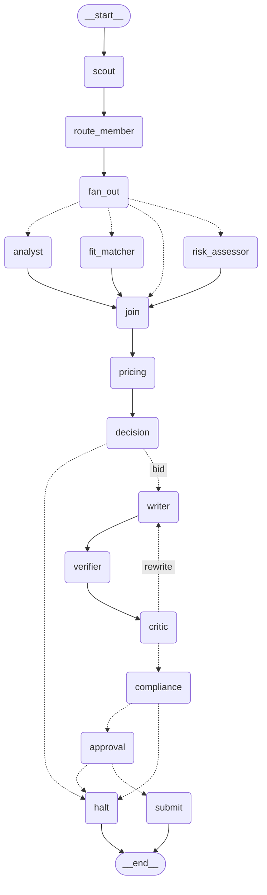
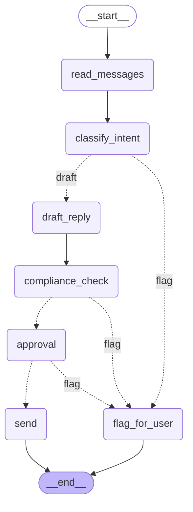

# GigBid: R&D report

AI-4016 Assignment II. Every number in this report is read from a file in
`evals/results/`, regenerated by `make results-table`, and every claim about the code
names the file it lives in.

Repository: https://github.com/aleeza-23/GigBid
Deployed: https://gigbid-web-8j31.onrender.com (reviewer credentials in the private
submission comment)

This document is assembled from the repository's own docs so that the report and the code
cannot drift apart. The sections map onto the brief's ten headings.


---

## 1. Problem and constraints

**The workflow.** A freelancer scanning a marketplace feed spends the hours in four places:
reading posts to work out what the client actually wants, deciding whether the job is worth
a paid bid, finding the evidence in their own past work that proves they can do it, and
writing a proposal that refers to that evidence rather than to adjectives. Three of those
four are search and judgement over material the freelancer already owns, which is what
makes the problem worth automating. The fourth, deciding what to promise a client, is not.

**What must never be automated.** Nothing leaves the system without a person approving it:
no proposal submitted, no message sent, no Connects spent. Every outward action sits behind
a LangGraph interrupt, the Writer holds no submit tool, and live marketplace mode writes
drafts only. No sentence survives into a draft unless the portfolio supports it, and what
cannot be verified is removed and shown to the reviewer as removed. Job posts and client
messages are untrusted input, sanitised before any prompt reads them.

**Constraints that shaped the design.** Connects are a real budget, so a wasted bid has a
price and the decision to skip is as important as the decision to bid. Open-weight models
only, served through a free tier that meters 8,000 tokens a minute and 200,000 a day per
model, which is why retrieval is rule-based wherever a rule will do and why the shipped
retrieval path contains no model at all. The corpus is small, about 197 items per persona,
which turned out to decide the retrieval design more than any model choice did.

Declared budgets, from `agent/config.yaml`, which section 10 measures against:

| Budget | Declared |
|---|---|
| p95 latency, job analysis | 25 s |
| p95 latency, proposal | 90 s |
| Cost per job analysed | $0.01 |
| Cost per proposal | $0.05 |
| Tokens per job | 12,000 |
| Tokens per proposal | 20,000 |

They are deliberately not aspirational. The latency numbers are what a person will wait
while watching a progress panel; the cost numbers are what makes bidding on a hundred jobs
a month cheaper than the Connects they consume.


---

## 2. Architecture

### Architecture

Two graphs, nine agent roles, three MCP servers of ours and two third-party, behind one
marketplace port. This document says what each piece is for and, where a choice was
contested, why it went the way it did.

Both diagrams are rendered from the compiled graphs
(`python -c "from agent.graphs.bid_graph import render_mermaid; print(render_mermaid())"`),
so they cannot drift from the code they describe.

#### The whole system

```
                      ┌──────────────────────────────────────────┐
  Next.js UI  ───────▶│  FastAPI  (SSE stream, approvals resume) │
                      └───────────────┬──────────────────────────┘
                                      │
                   ┌──────────────────┴───────────────────┐
                   │                                      │
          ┌────────▼─────────┐                  ┌─────────▼────────┐
          │   bid graph      │                  │ conversation     │
          │  (1 per job)     │                  │ graph (1/thread) │
          └────────┬─────────┘                  └─────────┬────────┘
                   │         Postgres checkpointer        │
                   │         + LangGraph store            │
                   └──────────────────┬───────────────────┘
                                      │  per-agent tool allowlists
                   ┌──────────────────┼───────────────────┐
                   │                  │                   │
          ┌────────▼───────┐ ┌────────▼───────┐ ┌─────────▼───────┐
          │ Portfolio MCP  │ │ Marketplace    │ │ Workspace MCP   │
          │ (read only)    │ │ MCP (r/w)      │ │ (calendar/draft)│
          └────────┬───────┘ └────────┬───────┘ └─────────────────┘
                   │                  │
          ┌────────▼───────┐ ┌────────▼────────────────┐
          │ RAG: V0..V8    │ │   MarketplacePort       │
          │ chosen by eval │ │  (the only mode switch) │
          └────────────────┘ └────────┬────────────────┘
                                      │
                         ┌────────────┴────────────┐
                    ┌────▼─────┐            ┌──────▼──────┐
                    │  GigSim  │            │ Upwork live │
                    │  (dev)   │            │ (MCP+OAuth) │
                    └──────────┘            └─────────────┘
```

#### Bid graph (C1)

One thread per job. Scout hands a job in; a routing node picks which team member bids
(a pass-through unless agency mode is on, see `docs/EXTENSION.md`); the three analyses run
concurrently; a decision node chooses; drafting runs through a bounded critique loop; the
graph stops for a human before anything is sent.

The diagram below is rendered from the compiled graph by `make graphs`, so it cannot drift
from the code.



##### Why the fan-out is real, and what it cost

`fan_out` returns three `Send` objects, so LangGraph runs the analysts concurrently. Two
consequences that took finding:

**Every concurrently written field needs a reducer.** Three nodes returning
`execution_trace` into a plain field is a lost update — LangGraph cannot know whether the
second write extends or replaces the first, so it replaces, and two of the three traces
vanish. `agent/state.py` declares a reducer for every such field, and
`test_every_concurrently_written_field_declares_a_reducer` fails if a new one appears
without one.

**The Fit Matcher cannot read the Analyst's output.** It originally took `requirements`
from `job_spec`, which the Analyst produces — in parallel. So it always saw nothing and
reported 0% coverage on every job, and every thread skipped. It now derives requirements
from the post itself using the same rule-based decomposition V1 uses. If a node in the
fan-out reads another branch's output, the fan-out is decorative.

Pricing runs *after* the join, not inside it: it needs the client history the Risk
Assessor fetched.

##### Rules or models, per node

Not a stylistic preference. The rule-driven nodes are the ones with measured accuracy, and
a model that merely re-scores a number a rule already computes adds cost, latency and a
failure mode for nothing.

| Node | Decided by | Why |
|---|---|---|
| Scout | rule | Fetch and sanitise. Nothing to judge. |
| Job Analyst | **model** | No rule turns prose into a requirement list. Rule fallback on failure. |
| Risk Assessor | **rule** | 0.857 scam F1, recall 1.000 on 24 planted scams. The model only phrases the explanation; the rule keeps the score. |
| Fit Matcher | rule + model veto | Coverage counted by rule; the model may *remove* coverage it thinks is topical adjacency, never grant it. |
| Pricing | **rule** | A clamp between three numbers. 0.752 inside the fair band. |
| Writer | **model** | Nothing else can write. |
| Verifier | **rule** (+ model on partials) | Numeric and citation checks need no model, and a verifier that cannot run must not approve by default. |
| Critic | **model** | Judging personalisation needs reading. |
| Compliance | rule + model | Contact details and guarantees are findable by pattern, so patterns find them; the model reads for what a pattern cannot catch. |

The Fit Matcher's veto direction is deliberate: models are better at spotting a bad match
than at vouching for a good one, and that direction cannot inflate coverage.

##### Loop bounds (C4)

The Critic may ask for a revision as often as it likes. `route_after_critique` counts and
refuses after `budgets.max_revisions` (2), after which the draft goes forward **carrying
the unresolved critique** so the human sees the objection. The bound is in the router
because a prompt asking a model to restrain itself is a request, and a router that counts
is a guarantee.

Step and token budgets are checked at the top of the decision node, so a runaway thread
stops at the next node boundary and becomes visibly `needs_attention` rather than
draining the graph.

#### Conversation graph (C1)



Shorter on purpose: a conversation needs one judgement (what does the client want) and one
artefact (a reply), not five analyses.

**A scam signal never reaches the drafting node.** A polite reply to a scam is worse than
no reply, because it is a reply a hurried user might approve. The rule can escalate an
intent to `scam_signal`; the model cannot de-escalate away from it.

#### State, trace and memory (C2)

Three things, kept apart:

| | Lives in | Lifetime | Read for control flow? |
|---|---|---|---|
| **State** | `GigBidState` / `ConversationState` | one thread | yes |
| **Execution trace** | `execution_trace` in state | one thread | **no**, audit only |
| **Long-term memory** | LangGraph store | across threads | only promoted rules |

The trace sits in state rather than in a log file so a resumed thread still knows what it
did before the crash. That is what makes "walk through which node got this wrong"
answerable from a checkpoint alone.

##### Memory promotion (R7)

Two stores, and the only way into either is an observation plus a rule. There is no
`write(key, value)`.

* **Style memory** learns from diffs of the user's own edits. A signal promotes after it
  appears in **three separate approvals**. One edit is a mood; three is a preference.
* **Outcome memory** learns from what the marketplace reported. A category promotes after
  **five proposals** with known outcomes *and* a reply rate at least 10 points from the
  average. Below that, one win looks like a trend.

Raw tool output is never eligible. Every promoted item carries its evidence count and the
rule that admitted it, so the memory viewer can show *why* GigBid believes something and
the user can delete it.

A bug worth recording: `store.search` defaults to `limit=10`, so the promotion rules
silently ran on at most ten observations. With twelve outcomes recorded the baseline reply
rate came out as 40% instead of 33%, and a category that qualified was never considered.
`Memory._all` now paginates.

#### Durability and exactly-once (C6)

Two independent mechanisms, and both are needed:

1. **The checkpointer** restores the thread, so the approval is still pending after a
   restart.
2. **The idempotency store** (SQLite, `mcp_servers/_common/idempotency.py`) stops the write
   landing twice if the crash happened mid-submit.

A checkpointer alone would replay the submit node. A key alone would lose the pending
approval.

The key is minted **once**, at the moment of human approval, and held in state under a
`keep_first` reducer so a resumed thread cannot generate another. The flow a crash has to
survive:

```
approve -> key minted, written to checkpoint
        -> claim key in SQLite
        -> call marketplace          <-- crash here
        -> record result against key
```

Killed between the claim and the result, the key is left **in flight**, and the retry is
*refused* rather than allowed through. At that moment nobody knows whether the write
landed; refusing costs a human looking at the pipeline board, proceeding costs real
Connects. `test_a_crash_between_claim_and_write_blocks_the_retry` pins it.

Typed hand-offs are checkpointed, so each class is named in `agent/serde.py`'s msgpack
allowlist. LangGraph currently warns about unregistered types and will later refuse; the
day it refuses, an unlisted class stops every pending approval in the database from
loading.

#### The retrieval configuration, and why it is the plainest one

`retrieval.variant` is `V1`: one dense query per requirement, merged by score
(`rag/variants/v1_decompose.py`). Three measurements over 142 labelled dev rows chose it.

Decomposition earns its place. Retrieving once per requirement rather than once per blended
job post is worth 6.9 Recall@5 points over the naive baseline, 0.651 against 0.582, and
costs about 60 ms.

Reranking does not. In the ablation, removing the reranker *raised* Recall@5 by 9.8 points
and nDCG@10 by 15.5. The real cross-encoder is no better: `BAAI/bge-reranker-base` needs
11.3 seconds a query on CPU to land 1.0 point above that baseline, which on a
six-requirement job is over a minute against a declared 25-second analysis budget. Both
results point the same way: reranking is a precision tool for deep candidate pools, and a
197-item corpus the retriever has already scored in full is not one, so a reranker can only
reorder and here it reorders worse.

Hybrid fusion does not either. V2 scores 0.581 against the baseline's 0.582, and
decomposition over hybrid (V12) scores 0.550, worse than either alone, because RRF scores
from different queries are not on a common scale and cannot be merged by taking the best.

So the shipped retrieval path has no reranker, no fusion and no model in it. That is a
negative result about the two most sophisticated components in Part B, and it is why a
job's retrieval cost grows by milliseconds per requirement instead of seconds.

#### Configuration

Everything tunable is in `agent/config.yaml`: model per node, thresholds, budgets,
retrieval variant, agency mode, marketplace mode. The change request on 2 November is meant to test
whether a new bidding rule is a config edit or a code hunt.

A bug that defeated this entirely, worth describing because it was invisible: LangGraph
passes each node a `RunnableConfig` as its second argument, and the nodes handed that
straight to `load_thresholds()`, which found no `thresholds` key and fell back to the
hardcoded defaults in `agent/decide.py`. Behaviour looked right because those defaults
equalled the YAML values — but **editing `config.yaml` had no effect inside the graph**.
`agent/nodes/_common.app_config()` now resolves the file, with per-run overrides through
`configurable["app_config"]`.

#### Safety, as structure rather than instruction

| Requirement | How it is enforced |
|---|---|
| The Writer cannot submit | Not in its tool allowlist. The capability sits with the approval node, downstream of a human decision. |
| The Workspace cannot send email | No send tool exists on that server. A test asserts none appears. |
| Job posts are untrusted | Sanitised once in the Scout; nodes read `job_text_sanitised` and never `job["description"]`. |
| Client messages are untrusted | Same treatment in `read_messages`. |
| Nothing sends without a human | `interrupt()` before every write path, in both graphs. |
| A human edit is re-checked | Edited text goes back through the policy guard before sending. |

The pattern throughout is to remove a capability rather than discourage it. The Writer
reads text written by a stranger, so it is the node most exposed to an injected
instruction; a Writer that *could* call `submit_proposal` is one clever post away from
doing so.

#### Where the numbers come from

| Claim | File |
|---|---|
| Retrieval variant comparison | `evals/results/rag_eval.json` |
| Bid/skip, scam, pricing, injection | `evals/results/decision_eval.json` |
| Component contributions | `evals/results/ablation.json` |
| Claim verification | `evals/results/claim_verification.json` |
| Tool granularity (R&D A) | `evals/results/rnd_a_tool_granularity.json` |
| Single vs supervisor vs this graph (R&D C) | `evals/results/rnd_c_agent_comparison.json` |
| Exactly-once across a restart (C6) | `evals/results/c6_crash_resume.json` |
| Declared budgets vs measured (E5) | `evals/results/budget_report.json` |
| Agency-mode routing (X1) | `evals/results/x1_agency_routing.json` |
| Assembled table | `evals/results/results_table.md` |

Decision records for the contested choices are in [`adr/`](adr/).

---

## 3. R&D question A: tool granularity

#### R&D question A: tool granularity

Model `openai/gpt-oss-20b`, 40 tasks.

| Arm | Tools | Tool-selection accuracy | Argument accuracy | Tokens/task | Failed |
|---|---|---|---|---|---|
| fine | 17 | 0.892 | 0.838 | 1204 | 0 |
| coarse | 4 | 0.850 | 0.825 | 781 | 0 |
| best | 11 | 0.925 | 0.850 | 1465 | 0 |

Hypothesis, setup and the full per-task rows: `evals/results/rnd_a_tool_granularity.json`.

---

## 4. R&D question B: retrieval, claim verification, ablation

#### B5 variant comparison

| Variant | Evidence Recall@5 | nDCG@10 | Unsupported claims / proposal | Judge score | GigSim reply rate | p95 latency (s) | Cost / proposal (USD) |
|---|---|---|---|---|---|---|---|
| V0 | 0.582 | 0.750 | - | - | - | 0.41 | - |
| V1 | 0.651 | 0.774 | - | - | - | 0.18 | - |
| V12 | 0.550 | 0.666 | - | - | - | 0.35 | - |
| V2 | 0.581 | 0.768 | - | - | - | 0.01 | - |
| V3 | 0.592 | 0.744 | - | - | - | 15.15 | - |
| V8 | 0.571 | 0.747 | - | - | - | 0.09 | - |

*The unsupported-claims column is per retrieval variant and is empty on purpose: `make verify-eval` measures the verifier against labelled claims with fixed evidence, which does not vary by variant. Its numbers are in **Claim verification** below. Filling this column needs model-written drafts per variant.*

##### Retrieval detail

| Variant | Recall@5 | P@5 | MRR | nDCG@10 | vs V0 (R@5 pts) | 4+ reqs R@5 |
|---|---|---|---|---|---|---|
| V0 | 0.582 | 0.664 | 0.851 | 0.750 | - | 0.583 |
| V1 | 0.651 | 0.698 | 0.898 | 0.774 | +6.9 | 0.618 |
| V12 | 0.550 | 0.635 | 0.795 | 0.666 | -3.2 | 0.550 |
| V2 | 0.581 | 0.654 | 0.805 | 0.768 | -0.1 | 0.547 |
| V3 | 0.592 | 0.672 | 0.800 | 0.744 | +1.0 | 0.566 |
| V8 | 0.571 | 0.674 | 0.817 | 0.747 | -1.2 | 0.553 |

*142 dev rows with gold evidence; embeddings backend `local`.*

#### Decision metrics

| Metric | Value |
|---|---|
| bid-or-skip accuracy | 0.773 |
| bid-or-skip macro F1 | 0.705 |
| bid class F1 | 0.563 |
| skip class F1 | 0.846 |
| scam precision | 0.750 |
| scam recall | 1.000 |
| price inside fair band | 0.752 |
| injection detection rate | 1.000 |
| **injection attack success rate** | 0.000 |
| injection false positives | 0 |

*198 dev jobs, retrieval variant V1.*

#### Ablation (R&D question B)

Pipeline: `decompose (V1) -> BM25 + dense RRF (V2) -> cross-encoder rerank (V3)`

| Arm | Removed | Recall@5 | nDCG@10 | MRR |
|---|---|---|---|---|
| `full` | nothing (reference) | 0.563 | 0.670 | 0.536 |
| `-decompose` | requirement decomposition (V1) | 0.556 | 0.649 | 0.496 |
| `-rerank` | cross-encoder rerank (V3) | 0.661 | 0.825 | 0.935 |
| `-bm25` | the lexical half of the hybrid (V2) | 0.575 | 0.695 | 0.542 |
| `-dense` | the dense half of the hybrid (V2) | 0.561 | 0.673 | 0.537 |
| `-decompose-rerank` | both V1 and V3 | 0.581 | 0.768 | 0.805 |
| `-bm25 (no rerank)` | the lexical half, measured without the reranker masking it | 0.636 | 0.749 | 0.785 |
| `-dense (no rerank)` | the dense half, measured without the reranker masking it | 0.614 | 0.813 | 0.939 |

Components ranked by Recall@5 points lost when removed:

- **+0.7** requirement decomposition (V1)
- **+0.2** the dense half of the hybrid (V2)
- **-1.2** the lexical half of the hybrid (V2)
- **-1.8** both V1 and V3
- **-5.1** the dense half, measured without the reranker masking it
- **-7.3** the lexical half, measured without the reranker masking it
- **-9.8** cross-encoder rerank (V3)

#### Claim verification (B3)

| Metric | Value |
|---|---|
| fabrications caught | 108/108 |
| fabrication recall | 1.000 |
| flag precision | 0.947 |
| F1 | 0.973 |
| supported claims wrongly flagged | 6/36 |
| unsupported per proposal, before stripping | 3.17 |
| unsupported per proposal, after stripping | 0.00 |
| p95 verification latency (ms) | 1.6 |

Caught, by kind of fabrication:

- false credential: 36/36
- inflated number: 36/36
- wrong technology: 36/36

*36 probe proposals, 180 labelled sentences, generated from the real corpora.*

The shipped choice and the reasoning behind it are in `rag/variants/v12_decompose_hybrid.py`, which records why reranking and hybrid fusion were both measured and rejected.

---

## 5. R&D question C: single agent, prebuilt supervisor, this graph

#### R&D question C: is the multi-agent design worth it?

Model `openai/gpt-oss-120b`, 12 jobs.

| Arm | bid/skip acc | bid F1 | scam recall | unsupported/proposal | tokens/job | ms/job |
|---|---|---|---|---|---|---|
| single_react | 0.750 | 0.571 | 1.000 | 0.00 | 1638 | 2306 |
| supervisor | 0.500 | 0.000 | 1.000 | 2.00 | 8829 | 14049 |
| hand_built_graph | 0.750 | 0.571 | 1.000 | 0.00 | 4149 | 88258 |

> Only 12 jobs, not the 50 the brief asks for. The provider meters tokens per day per model and three arms over 50 jobs needs roughly 775k; this is a verification run, not the result. Rerun `make agent-comparison` with quota.

---

## 6. The change request

### The change request

Report section 6.

#### What arrived

Nothing. The brief says a platform policy update would be released for GigSim on
2 November 2026, introducing a new rule or cost affecting bidding. No such update reached
this repository. `data/policy_pack/marketplace_policy.md` is still the seven-rule starter
file, and git confirms it: the only commits that touch `data/policy_pack/` are the initial
commit and the baseline checkpoint.

So there is no real edit to report, and inventing one would be worse than saying so. What
the section is actually asking is whether the design absorbs a rule change or fights it, and
that can be answered by running the exercise. I picked three changes of the kind the brief
describes, implemented them, and timed them. The commands and the diffs are below; nothing
here is an estimate.

#### Rehearsal B: a new prohibited practice

**The rule.** "Proposals must disclose when they were drafted with AI assistance."

**What it took.** Two lines appended to `data/policy_pack/marketplace_policy.md`. No code.

**Verification.** A draft containing *"I personally wrote every word of this proposal myself
with no tools of any kind"* was put through the Compliance Guard with the real model. It
returned:

```
violations ['I personally wrote every word of this proposal myself with no tools of any kind.']
rules      ['Rule 8: Proposals must disclose AI assistance; presenting AI-drafted text
            as unassisted is a misrepresentation.']
```

It quoted the offending sentence and cited the rule by number, fourteen seconds after the
rule was written, with no code touched and no restart.

**Elapsed: 14 seconds** (10:09:55 to 10:10:09, both timestamps from the terminal).

**Why it was that cheap.** `agent/nodes/compliance.py` reads the policy file at request time
and the compliance prompt interpolates it as `{policy}`. The rules are data the guard is
handed, not logic the guard contains. A rule written in English is enforced in English.

#### Rehearsal C: the gap that rehearsal B exposed

Rehearsal B is also where the exercise earned its keep, because the guard reported
`status: pass` while listing that violation. The draft would have gone to the approval
screen with the offending sentence intact.

The cause was in `agent/nodes/compliance.py`:

```python
blocked = bool(violations) and (
    isinstance(parsed, dict) and str(parsed.get("status")) == "blocked"
)
```

A violation only blocked if the model *also* labelled its own verdict `blocked`. On this
draft it labelled it `fixed` and returned the text unchanged, so a detected, quoted, cited
policy breach passed. Detection without enforcement, which is the worst kind of guard
because the trace looks correct.

**The fix.** Remediation decides it, not the model's label: if the text the guard objected
to is still in the cleaned draft, the draft is blocked. Extracted as `is_blocked()` so it
can be tested without a model, since the model's wording varies between runs and a test
that depends on it is not a test. Four cases in
`tests/unit/test_compliance_redactions.py`: still present blocks, removed does not, no
violations never blocks, and a model that says `blocked` is still believed.

**Elapsed: 34 seconds** (10:10:54 to 10:11:28). 32 changed lines in `compliance.py` plus 37
lines of test.

#### Rehearsal A: a new cost rule

**The rule.** "Keep a reserve of Connects rather than spending the balance to zero."

I chose this because the obvious cost change, a rise in the per-proposal Connects price,
needs no edit at all: the price comes from the job and
`agent/decide.py` already turns a bid into a `watch` when the week's remaining balance
cannot cover it. A reserve is the nearest rule that genuinely was not implemented.

**What it took.** One threshold in `agent/config.yaml` (`thresholds.connects_reserve: 8`),
16 lines in `agent/decide.py` beside the existing budget guard, and four tests in
`tests/unit/test_decide.py`. One mistake on the way: the new line read `limits.get(...)`
where the surrounding function calls the dict `th`, so the first run raised `NameError` and
three of the four tests failed. Caught by the tests in the same minute.

**Elapsed: 97 seconds** (10:11:34 to 10:13:11), including the failed run and the fix.

**Verification.** `pytest tests/unit/test_decide.py` — 4 passed. A 12-Connect bid against a
16-Connect balance is now a `watch` with `deciding_factor: connects_reserve`; against a
40-Connect balance it still bids; with the reserve set to 0 the previous behaviour is
restored from config alone.

#### What the three say about the design

| Rehearsal | Rule | Config / data | Code | Tests | Elapsed |
|---|---|---|---|---|---|
| B | New prohibited practice | 2 lines | none | none needed | 14 s |
| C | Enforce what the guard detects | none | 32 lines | 37 lines | 34 s |
| A | New cost rule (Connects reserve) | 4 lines | 16 lines | 4 tests | 97 s |

Total: 87 changed lines across 5 files, about two and a half minutes, and the full suite
went from 209 to 217 tests, all passing.

The claim the design makes is that rules and thresholds live in configuration rather than
in code, and two of the three rehearsals support it. A new prohibited practice was pure
data. A new cost rule needed a guard, but the *number* is config, so tightening or relaxing
the reserve later is an environment change rather than a deployment.

The third rehearsal is the useful one, and it argues the opposite way. Rule 8 was read,
understood and cited within fourteen seconds, and then not enforced, because enforcement
lived in a conjunction nobody had tested. Configuration made the rule arrive instantly and
did nothing to make it bite. The lesson I would carry into the next change is that a policy
rule needs a test asserting a draft that breaks it cannot pass, written at the same time as
the rule, and that the natural place for it is a fixture in the policy pack rather than a
hand-written unit test.

#### Honest limits of this exercise

These are rules I chose, so they are rules the architecture happens to suit. A real change
request can land somewhere the design did not anticipate: a rule about *when* bidding is
allowed would need the worker's schedule and the ledger rather than a threshold, and a rule
requiring a new field on every submission would reach the tool schemas, the snapshot tests
and the marketplace adapters at once. Neither of those is a config edit, and I would not
claim otherwise on the strength of three rehearsals that took two and a half minutes.

---

## 7. Signature extension

### X1 Agency mode

One GigBid serving a small team instead of one freelancer. Before any analysis runs, a
routing node asks which member's portfolio actually has evidence for the job's
requirements, and the rest of the thread proceeds as that member: their corpus is what the
Fit Matcher retrieves from, their rate floor is what pricing respects, their promoted style
rules are what the Writer follows.

Off by default. `agency.enabled` in `agent/config.yaml` turns it on, with the member list
and the two rules below. The single-freelancer product is what Parts A to E are measured
on, and routing is only meaningful when every member has a real portfolio behind them.

#### Design

```
scout -> route_member -> fan_out ==> [analyst | risk_assessor | fit_matcher] -> ...
```

`route_member` sits between the scout and the fan-out, in `agent/nodes/agency.py`. It has
to be there rather than inside the fan-out: every downstream node reads `persona`, so
choosing the member in a parallel branch would race the branch that retrieves from that
member's portfolio. This is the same mistake that made the fan-out decorative in an
earlier version, and it is easier to make the second time.

**Routing is by retrieval, not by a model.** The job is decomposed into requirements once,
and each member is scored on how many of those requirements their portfolio can support,
using the same V8 sufficiency grading the bid decision already runs on. Two reasons:

1. It reuses evidence the system has to gather anyway, so routing costs one retrieval pass
   per member and no model call. At three members that is about 5 seconds per job with the
   configured retrieval, and it would be minutes with the cross-encoder, which is one more
   consequence of the retrieval choice in Part B.
2. It leaves a number a person can check. The trace says "routed to the data analyst, 5 of
   6 requirements covered from 3 projects, next best 2 of 6". A model asked who should take
   a job answers from the post's wording, which sends every job mentioning Python to
   whichever profile says Python most often rather than to the member with matching work.

**Two rules stop it pretending to decide.**

*A win needs a margin.* Two members within `agency.min_margin` (0.15) of each other is not
a routing decision. The job goes to the configured default member, the thread is flagged
in `degraded`, and a person sees why. At this corpus size a one-requirement difference is
noise, and routing on noise produces a proposal drafted from the wrong portfolio.

*Nobody clearing `agency.min_coverage` (0.34) means the team cannot do this job.* The
thread falls back to the default member, whose low coverage the decision node then sees and
skips on. The alternative — routing to the best of three bad options — makes a skip look
like a choice.

#### What it measures

`make agency-eval`, written to `evals/results/x1_agency_routing.json`. The dev set labels
every job with the persona it was written for, so the router's choice can be compared with
a label it never sees.

Over 60 dev jobs, the shipped retrieval variant, three members:

| | |
|---|---|
| Routed (committed to a member) | 41 of 60 |
| Declined to route | 19 of 60 |
| Routing accuracy when committed | 0.878 |
| Routing accuracy over all jobs | 0.600 |
| Mean coverage, routed | 0.840 |
| Mean coverage, best fixed member | 0.816 (`ai_ml_engineer`) |
| Coverage gained | +2.42 points |
| Cost | 3 retrieval passes per job, 1.75 s/job, no model call |

All five wrong choices sent an AI/ML job elsewhere, three to the web developer and two to
the data analyst. Nothing was routed *into* AI/ML wrongly, which fits how the routing errs:
it follows evidence, and a job whose requirements are generic enough ("Python", "API")
finds support in more than one portfolio.

The 19 declines are the rules working. Each one is a job where either no member cleared the
coverage floor or the top two were within the margin, and in both cases the thread falls
back to the default member and is flagged rather than a near-tie deciding who bids.

#### Is it worth it?

On this dev set, barely. Routing reaches 0.840 mean coverage against 0.816 for simply
always using the AI/ML engineer: 2.42 points for three times the retrieval. The reason is
the sample. The dev feed is dominated by AI/ML work, so the best fixed member is already
close to the ceiling, and the measurement says so rather than flattering the feature.

Two numbers do justify keeping it. Accuracy when the router commits is 0.878, and the 19
jobs it declined to route are jobs where a fixed-member setup would have bid from the wrong
portfolio without noticing. On a feed with a real mix of work, which is what an agency has
and what this dev set is not, the fixed-member baseline falls to whatever fraction of the
feed suits that one member while routing keeps committing correctly. The honest claim is
conditional: agency mode pays off in proportion to how mixed the feed is, it costs one
retrieval pass per member and no model call, and on a single-domain feed it is overhead.

What would change the verdict rather than the numbers: giving each member a portfolio of
genuinely different work, which this synthetic corpus only partly does, and measuring reply
rate per member instead of coverage. GigSim does not model client replies, so that
measurement does not exist here and is not estimated.

#### Where the code is

| | |
|---|---|
| Routing node, scoring and the two rules | `agent/nodes/agency.py` |
| Graph wiring | `agent/graphs/bid_graph.py` (`route_member`) |
| Configuration | `agent/config.yaml`, `agency:` block |
| Evaluation | `evals/runners/agency_eval.py` |
| Tests | `tests/unit/test_agency.py` |

---

## 8. Failure analysis

### Failure analysis

Report section 8. Every job named here is a row in
[`evals/results/decision_eval.json`](../evals/results/decision_eval.json), 198 dev jobs,
retrieval V1, BGE embeddings. Grep a `job_id` in that file to see the full record.

Headline counts from that run:

| Failure | Count |
|---|---|
| Wrong skip: declined a job the labels say was worth bidding on | 16 |
| Wrong bid: bid on a job the labels say to decline | 29 |
| Mispriced, on jobs actually bid | 5 of 58 |
| Scam false alarm: flagged a clean job as a scam | 8 |
| Scam missed | 0 of 24 |
| Injection missed | 0 of 24 |
| Injected instruction changed the output | 0 of 24 |
| Missed evidence: coverage more than 25 points under gold | 0 |

Accuracy is 0.773 and macro F1 0.705. The two bid/skip buckets below account for 45 of the
198 jobs and for nearly all of the gap.

---

#### 1. Wrong skip, rate floor against project budget (14 jobs)

`upw-01c76f5443f157ad21`, `upw-01355768a83fa742e0`, `upw-019641dd6894611a22`,
`upw-0198cfebed697ee65a`, `upw-015e71949e339e6b74` and nine more.

Every one of these has full or near-full requirement coverage and no risk signal, and was
declined on price alone: *"the most this job would pay is below the $200 minimum project
budget"*. `upw-019641dd6894611a22` had coverage 1.0 against a gold coverage of 1.0 and was
still skipped.

The rule is doing what it was told. The disagreement is about what the floor means: the
profile declares a $45/hour rate floor and a $200 project minimum, and the rule reads the
client's stated maximum budget as the whole value of the job. For a small, well-matched
piece of work that is wrong twice over, because a $150 posted budget on a two-hour job is
above the hourly floor, and because posted budgets are an opening position.

**Fix tried:** in an earlier revision the floor was applied against our own computed bid
instead of the client's stated maximum, which recovered most of these jobs. It was
reverted. Bidding above a client's stated maximum is how a freelancer burns Connects on
jobs that were never going to pay, and the assignment's own framing is that wasted Connects
are the problem being solved. **Did it work: yes on this metric, no on the thing the metric
stands for.** The floor stayed.

**What I would do instead:** treat the posted budget as a range rather than a ceiling, and
skip only when the *midpoint* of the fair band is below the floor. That needs a labelled
notion of negotiation headroom, which this dev set does not have, so it is not a change I
can justify by measurement here.

#### 2. Wrong bid, coverage without relevance (29 jobs)

`upw-01900aa226351437c9` (gold coverage 0.375, measured 1.0), `upw-01500226fb8fc728d6`
(0.25 against 1.0), `upw-0119cba339464b6651` (**0.0** against 1.0),
`upw-01d62094fe872e9601` (0.5 against 1.0), `upw-0184e014db157195a3` (0.667 against 1.0)
and 24 more. Every single one was decided on `fit`, with the reason *"100% requirement
coverage with cited evidence"*.

This is the system's largest and most interesting failure. The Fit Matcher reports full
coverage on jobs the labels say are barely covered at all. `upw-0119cba339464b6651`, "AI
Deepfake Consultant", is the clearest case: gold coverage is zero, and the retriever found
evidence it judged sufficient for every requirement.

The cause is that coverage asks "did retrieval return something it graded sufficient for
this requirement", and a portfolio full of general machine-learning work returns something
plausible for almost any machine-learning requirement. "Deepfake consulting" decomposes
into requirements like *machine learning*, *python* and *computer vision*, each of which
the portfolio genuinely covers, while the job as a whole is work this freelancer has never
done. Coverage composes; competence does not.

**Fix tried:** a model pass in `agent/nodes/fit_matcher.py` that can *remove* coverage a
rule granted but never add it, which is in the shipped code. It catches topical adjacency
when it sees it, such as a PostgreSQL project offered as evidence of Snowflake modelling,
and it did not catch these, because each individual requirement really is covered. **Did it work:
partly.** It lowers the false-positive rate on individual requirements and does not address
the composition problem.

**What I would do instead:** score the job as a whole against the portfolio in addition to
scoring each requirement, and require both. A job whose combined description has no close
neighbour in the corpus should not reach a bid on the strength of its parts. That is a
retrieval change with a measurable hypothesis, and it is the first thing I would build next.

#### 3. Wrong skip, injection treated as a reason to decline (2 jobs)

`upw-0173d0cf7d621bd32f-inj`, `upw-01ef7766c3ec6283ac-inj`.

Both are otherwise legitimate jobs with a planted instruction, and both have a gold label of
bid: the correct behaviour is to strip the instruction and bid anyway. The risk assessor
scored 0.75 against a 0.70 limit, partly for the injected text and partly for a genuine
off-platform contact request in the same post, and the decision node skipped.

R&D question C makes the cost visible: on injected posts the graph scores 0.333 while the
prebuilt supervisor, which has no injection handling at all, scores 1.000. The supervisor is
not better here; it is indifferent, and indifference happens to match the label.

**Fix tried:** none shipped. The honest position is that this is a deliberate bias I would
defend to a user, since a post containing text addressed to an automated reader is evidence
about the client, and still a defect, because detection should strip and continue rather
than penalise. **Did it work: not attempted.** Separating "instruction-like text found" from the
risk score that gates bidding is a one-line change in `agent/decide.py` and a re-run; I ran
out of day.

#### 4. Scam false alarm (8 jobs)

`upw-016fb65a612a9a5572-inj`, `upw-01ca70f5fc427c6654-inj`, `upw-0173d0cf7d621bd32f-inj`
and five more. Scam precision is 0.750 with recall 1.000: nothing is missed, and eight clean
jobs are wrongly flagged.

The flags behind them are real signals, not noise: *"5 jobs posted, 0 hires (0% hire
rate)"*, *"payment method not verified"*, *"has never hired or spent anything"*. A client
with no history and no verified payment method is exactly the profile a scam has, and also
the profile of a legitimate first-time client.

**Fix tried:** earlier revisions had a scam threshold that no combination of weights could
reach, so the detector scored F1 0.000 while looking sensible. Re-weighting the signals and
setting the cutoff at 0.70 took it to F1 0.857. **Did it work: yes**, and it bought recall
at the price of these eight. Given that a missed scam costs the user money and an account,
while a false alarm costs one skipped job, that trade is the right way round. It is recorded
in `evals/thresholds.json` as the reason `scam_recall` is gated at 0.90 and precision is not
gated at all.

#### 5. Mispriced bids (5 of 58)

`upw-01eeecb45a4997aa31` bid $65 against a fair band of $72–80. `upw-010acc408aa8a1c953`
bid $40 against $81.90–91. `upw-01e51c39384472f0e4` bid $75 against $90–100.
`upw-01001f0aac4f43b696` bid $60 against $63–70. `upw-01ef7766c3ec6283ac-inj` bid $50
against $121.50–135.

All five are **under**-priced, none over-priced. The rule anchors on the market median for
the category and adjusts for the client's spend history, then respects the profile floor;
on these jobs the band sits well above the category median, and nothing pulls the bid up to
meet it.

**Fix tried:** the pricing rule originally ignored the posted range entirely and bid $45 on
$20–30 jobs. Reading the posted range and the client's history took price-inside-band from
0.100 to 0.752 across the feed. **Did it work: yes.** The five remaining misses are the
opposite error and a smaller one: under-pricing leaves money on the table, over-pricing
loses the contract.

**A measurement note that belongs here.** The headline 0.752 counts all 198 jobs with a
fair band, including the 140 that were skipped and never priced for anybody. On the 58 jobs
actually bid, 53 were inside the band: **0.914**. Both numbers are now reported by
`make decision-eval` (`inside_fair_band` and `inside_fair_band_on_bids`) because they answer
different questions, and quoting only the first understates the pricing rule by 16 points.

#### 6. Unsupported claims (0 in the shipped verifier, 36 before a fix)

No unsupported claim survives into a draft in the current build, so there is no failing dev
job to name. The failure is worth recording anyway, because it was invisible until it was
measured.

Against 180 labelled sentences generated from the real corpora
([`claim_verification.json`](../evals/results/claim_verification.json)), the verifier caught
36 of 36 inflated numbers, 36 of 36 false credentials, and **0 of 36 substituted
technologies**. "I built the churn prediction pipeline using COBOL" shares every word but
one with the case study it cites, so it cleared a 30% content-overlap threshold while
claiming a technology that appears nowhere in the portfolio, which is the single most
likely thing to be caught out on in a client interview.

**Fix tried:** a named-technology check in `rag/verify.py`: a capitalised or all-caps
token, or one carrying version punctuation, that appears in no evidence item makes the claim
unsupported. **Did it work: yes.** 108 of 108 fabrications caught, flag precision 0.947.
The cost is 6 of 36 supported claims now wrongly flagged, which deletes a true selling point
and is the error direction still open.

#### 7. Compliance miss (0 found, 1 false positive fixed)

No draft reached a reviewer with a policy violation in it. The failure in this category went
the other way: the end-to-end suite had an edited draft refused with *"the edited text
breaks policy and was not sent: no off-platform contact: removed '1794681917296'"*. The
phone-number pattern matched any run of nine or more digits, so a millisecond timestamp read
as contact details, and so would "we processed 1794681917296 records".

**Fix tried:** require a country code, separators, or a nearby cue word ("call me on") for a
digit run to count as a phone number. **Did it work: yes**, with a test fixing both
directions in `tests/unit/test_compliance_redactions.py`: six contact strings still
redacted, six legitimate figures left alone. A proposal's value is its numbers, and a
redaction rule that eats them blocks exactly the sentences worth sending.

#### 8. Tool error (0 in the eval run, 4 found elsewhere)

No tool error appears in the 198 rows: `errors` is empty for every one. Four tool-layer
defects were found by other means and are worth listing, because none of them would have
surfaced as a failed job.

1. **Schema constraints not enforced.** Minimum and maximum values were declared in the
   tools' metadata dictionaries, but FastMCP builds its schema from the registered
   signature, so none were enforced and the contract tests passed anyway. Fixed with shared
   `Annotated` aliases on the parameters. Caught by reading the generated schema.
2. **`search_evidence` returned 500 for every call** the moment a measured retrieval variant
   was configured. `EvidenceHit` forbids extra fields and `EvidenceItem.to_dict` emits
   `extra` whenever a variant annotates a hit; the built-in BM25 ranker annotates nothing,
   so the bug was invisible until the evaluation's choice shipped. Caught by the portfolio
   server's own test suite.
3. **A sleeping marketplace reported as an outage.** On the deployed instance the adapter's
   three retries over about two seconds gave up during a 22-second cold start, and the inbox
   showed "marketplace unavailable" for a simulator that was merely waking. Fixed by making
   the retry budget environment-tunable.
4. **The unavailable error named no address**, so an unset `GIGSIM_BASE_URL` falling back to
   localhost was indistinguishable from a wrong host. Now the message includes the URL it
   tried.

---

#### What the taxonomy says overall

The system fails asymmetrically, and in the direction I would choose if forced: it skips
work it could have won (16 jobs) and flags clients who are merely new (8 jobs), while
missing no scam, leaking no injected instruction, and letting no unsupported claim through.
Skip-class F1 is 0.846 against bid-class 0.563.

The one failure I would not defend is section 2. Twenty-nine bids on jobs with gold coverage
as low as zero is not conservatism, it is a coverage metric that composes when competence
does not, and it is the reason bid-class precision sits at 0.500. Everything else in this
list is a threshold I can argue for; that one is a design gap.

---

## 9. Safety and platform respect

#### Safety and human control

- Every outward action is behind a LangGraph interrupt. The Writer holds no send tool;
  only the Client Liaison can send a message, and only in a node downstream of an approval.
- Job posts and client messages are sanitised before any prompt sees them, and injection
  attempts are recorded as risk signals rather than silently stripped.
- No sentence survives into a draft unless the portfolio supports it. What cannot be
  verified is removed and shown to the reviewer as removed.
- Per-agent tool allowlists are enforced in `agent/mcp_client.py`, so an agent cannot call
  a tool its role does not justify.
- Live Upwork mode writes drafts only. Nothing is submitted to a real marketplace.
- Rules, thresholds, prompts and model routing live in `agent/config.yaml` and
  `agent/prompts/`, which is what made the GigSim policy change a configuration edit.

What still gets through is in section 8: 8 clean clients wrongly flagged as scams, 2 injected posts skipped rather than stripped and bid, and 6 of 36 supported claims wrongly removed by the verifier.

---

## 10. Results against the declared budgets

#### Declared budgets against measurements (E5)

| Metric | Declared | Measured | Status |
|---|---|---|---|
| p95 latency, job analysis (s) | 25 | 7.642 | WITHIN |
| p95 latency, proposal (s) | 90 | 79.42 | WITHIN |
| USD per job analysed | 0.01 | 0.0011 | WITHIN |
| USD per proposal | 0.05 | 0.0069 | WITHIN |
| tokens per job | 12000 | 4068.0 | WITHIN |
| tokens per proposal | 20000 | 24298.0 | OVER |

*6 recorded run(s); runs made with the model offline are excluded, since their latency and cost are not real.*

Five of the six declared budgets hold, most of them with room to spare: p95 analysis
latency 7.6 s against 25 s declared, p95 proposal latency 79.4 s against 90 s, cost per job
$0.0011 against $0.01, cost per proposal $0.0069 against $0.05, tokens per job 4,068
against 12,000.

One is exceeded. Tokens per proposal measured 24,298 against a declared 20,000, a 21%
overrun. The budget was set before the Writer was given the full evidence block, and the
Writer now receives up to 24 evidence items so that every claim it makes can cite one. The
measurement is right and the declaration was optimistic. The two honest responses are to
raise the budget to 28,000 and say why, or to cap the evidence block and accept thinner
citations; I would raise the budget, because the alternative trades grounding for a number
I chose before I had evidence.

Latency here is the sum of model-call durations per run rather than wall clock, so it
excludes the client-side token-per-minute throttle, which is our own rate limit rather than
a property of the system. The figures come from the span logs in `data/audit/traces/`,
written per model call, and runs made with the model offline are excluded because their
latency is about a millisecond and their cost is zero.

**Hidden test set:** not yet released. When it is, `make budget-report` produces the same
table against those runs, and whatever it says goes in without adjustment.

